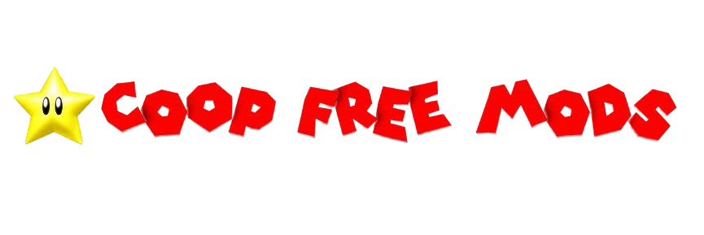

# Coop Free Mods

**Sitio web de mods gratis para Super Mario 64 Co-op** (SM64 Co-op DX, SM64 EX Co-op y DX + EX).

🌐 **Web:** [https://coop-free-mods.vercel.app](https://coop-free-mods.vercel.app)  
💬 **Discord:** [https://discord.gg/RAbR6xBpcR](https://discord.gg/RAbR6xBpcR)  
📦 **Repo:** [github.com/ra4107187-prog/CoopFreeMods](https://github.com/ra4107187-prog/CoopFreeMods)

---

## ¿Qué es?

Coop Free Mods es una biblioteca comunitaria donde podés:

- **Buscar y descargar** mods de SM64 Co-op
- **Publicar** tus propios mods (archivo o link externo)
- **Comentar, dar likes y reseñas**
- Usar **foros**, **videos (CoopTube)**, **packs**, **eventos** y más

Los datos se guardan en la nube (Supabase), así que no se pierden al reiniciar el hosting.

> Proyecto iniciado por **@Ellos (them)** y continuado por la comunidad / **@SuperAaron64**.  
> Este sitio **no está afiliado a Nintendo**.

---

## Características principales

### Mods
- Publicación con capturas, categorías y tags
- Descargas, likes (👍) y reseñas con estrellas
- Comentarios y respuestas (con menciones `@usuario`)
- **Mod de la semana** y **Top 10** por descargas
- **Packs de mods** (colecciones tipo playlist)
- **Colaboradores** en un mismo mod
- Link externo opcional (MediaFire, Google Drive, Mega)
- Escaneo básico de archivos peligrosos en ZIPs

### Comunidad
- Cuentas, perfiles y **foto de perfil**
- Seguir usuarios y **mensajes privados**
- **Foros** con visitas y respuestas
- **Novedades** (solo moderadores)
- **Eventos** (torneos, hangouts, quedadas)
- **Autores destacados** (ranking por descargas)
- **Logros** automáticos según actividad
- Notificaciones (comentarios, likes, menciones, etc.)

### CoopTube
- Videos con enlace de YouTube embebido
- Likes, comentarios y favoritos
- Playlists de videos

### Extras
- **ToadCode**: asistente de IA para código Lua / mods
- Easter egg: **jugar SM64** en el navegador
- Configuración en el navegador:
  - Cursor SM64
  - Música de fondo
  - Sonido de click
  - Vista lista / tarjetas (2–6 por fila o gigantes)
  - Preferencias de notificaciones

---
## Moderación

Por defecto el moderador principal es la cuenta configurada en el código (`SuperAaron64`).  
Los moderadores pueden, entre otras cosas:

- Eliminar mods / comentarios
- Banear o desbanear cuentas
- Marcar el **mod de la semana**
- Publicar **novedades**

---

## Roadmap / ideas

- Chat global en vivo
- Añadir mods a un pack desde la ficha (sin copiar IDs)
- Más logros y badges en el perfil
- Mejoras de SEO y PWA
- Traducción parcial EN

---

## Contribuciones

Las ideas y pull requests son bienvenidos.

1. Fork del repo  
2. Rama con tu cambio  
3. Pull request describiendo qué hiciste  

Si encontrás un bug, abrí un issue o avisá en Discord.

---

## Licencia y créditos

- Código de la web: proyecto comunitario (consultar con los mantenedores si reutilizás partes grandes).
- Los **mods** pertenecen a sus respectivos autores.
- Super Mario, Mario y elementos relacionados son propiedad de **Nintendo**.
- Este sitio es un proyecto de fans **no oficial** y no está afiliado a Nintendo.

---

## Contacto

- Web: [coop-free-mods.vercel.app](https://coop-free-mods.vercel.app)
- Discord: [discord.gg/RAbR6xBpcR](https://discord.gg/RAbR6xBpcR)
- GitHub: [ra4107187-prog/CoopFreeMods](https://github.com/ra4107187-prog/CoopFreeMods)

¡Gracias por ser parte de la comunidad de SM64 Co-op! 🍄

(los commits no estan bien nombrados, la mayoria solo se llaman a)
